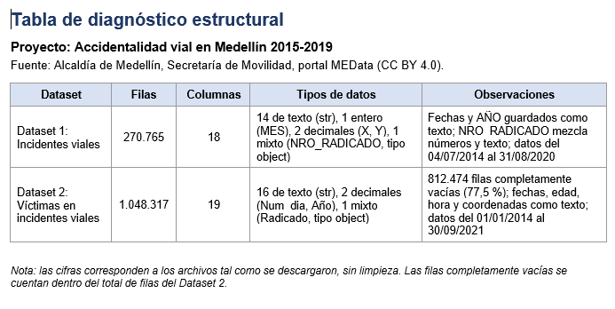
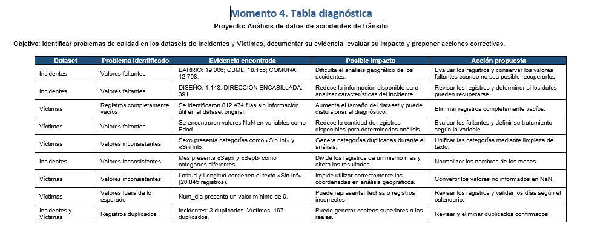

# MOMENTO 1: RECONOCIMIENTO DEL PROYECTO Y DE LOS DATASETS

# Accidentalidad vial en Medellín 2019-2023

AUTOR:Juan David 

# PROPOSITO

Ayudar a la Secretaría de Movilidad a planear controles viales, campañas de prevención y presencia de agentes de tránsito en las épocas más críticas.

## PREGUNTA ANALITICA

¿En qué meses del año se concentra el mayor número de accidentes de tránsito en Medellín entre 2015 y 2019?

# PAGINAS DE EXTRACCION DE INFORMACION

FUENTE: Alcaldia de Medellin ,Secretaria de Movilidad ,Portal MEData

Conjunto: (Identificador 1-023-25-000360) Licencia CC BY 4.0

Descargado el 2/11/2026

# Datasets

Incidentes viales | `incidentes_viales.csv` | Accidentes de tránsito registrados por la Secretaría de Movilidad de Medellín. Cada fila es un accidente, con fecha, mes, clase, gravedad, diseño de la vía, comuna, barrio y coordenadas. | Es la fuente principal: permite contar accidentes por mes entre 2015 y 2019. 

Victimas en incidentes viales | `Mede_Victimas_inci.csv` | Víctimas de accidentes de tránsito registradas por la Secretaría de Movilidad. Cada fila es una víctima, con gravedad, sexo, edad, condición, fecha, comuna y barrio. | Complementa el análisis con el número y el perfil de las víctimas en los meses críticos. 

# MOMENTO 3:TABLA INFORME DIAGNOSTICO

# MOMENTO 4 : DIAGNOSTICO INICIAL DE CALIDAD

# ACCION DE LIMPIEZA PROPUESTA

# 1- Tratamiento de registros duplicados

Eliminar los registros duplicados 

# 2- Tratamiento de valores faltantes

Se propone analizar los valores faltantes de cada variable para determinar su importancia dentro del estudio. Dependiendo de la naturaleza de los datos, se evaluará si es conveniente conservarlos, recuperarlos mediante fuentes confiables o excluir determinados registros cuando exista una justificación técnica.

 # 3- Normalizacion de variable categorica

 Se realizará una estandarización de los valores de texto para evitar diferencias en la clasificación de una misma categoría. Se corregirán inconsistencias relacionadas con mayúsculas, minúsculas, espacios y abreviaciones, como ocurre con los valores Sep y Sept en la variable Mes.

 # 4- Correcion de tipos de datos

 Se revisarán los tipos de datos de las columnas para garantizar que cada variable tenga un formato adecuado según su naturaleza. Se prestará especial atención a las variables numéricas, categóricas y temporales, facilitando así su utilización en operaciones estadísticas.

 # 5- Validacion de fechas

 Se verificará la coherencia de las variables relacionadas con fechas, incluyendo día, mes y año. Se buscarán valores fuera de los rangos permitidos y posibles inconsistencias que puedan afectar el análisis temporal de los accidentes de tránsito.

 # 6- Validacion y limpieza de coordenadas geograficas

 Se propone transformar los valores no informados de latitud y longitud en valores nulos, además de verificar que las coordenadas numéricas se encuentren dentro de los rangos geográficos válidos. Esto permitirá preparar la información para posibles análisis de distribución espacial.

 # 7- Identificacion y valoracion de valores atipicos

 Se analizarán los valores extremos presentes en las variables numéricas, con el objetivo de determinar si corresponden a situaciones reales o posibles errores de registro. No se eliminarán automáticamente, ya que podrían representar características importantes de los accidentes.

 

